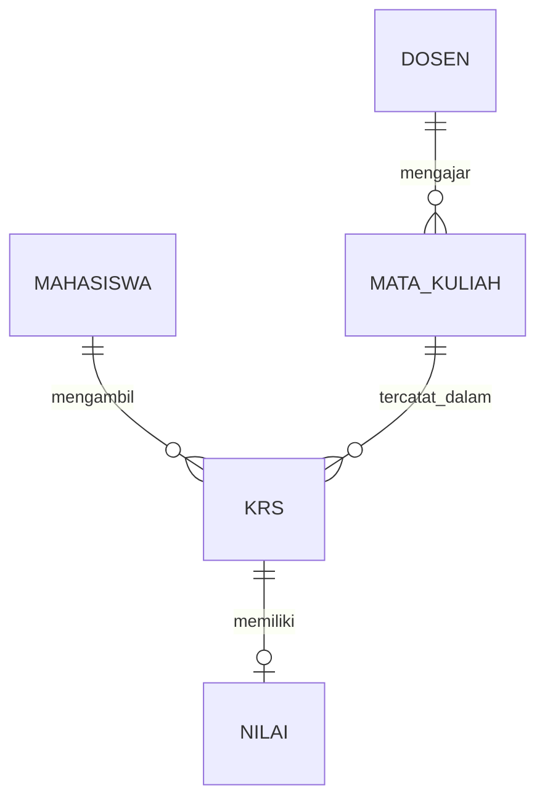

# Diagram Relasi Tabel Sistem Informasi Akademik

Diagram berikut menggambarkan hubungan antara lima tabel pada rancangan Sistem Informasi Akademik.

## Keterangan Relasi

- **Dosen — Mata Kuliah (1:N):** satu dosen dapat mengajar beberapa mata kuliah.
- **Mahasiswa — KRS (1:N):** satu mahasiswa dapat memiliki beberapa data KRS.
- **Mata Kuliah — KRS (1:N):** satu mata kuliah dapat tercatat pada banyak data KRS.
- **KRS — Nilai (1:1):** satu data KRS berhubungan dengan satu data nilai dalam rancangan ini.

Tabel KRS menjadi penghubung antara Mahasiswa dan Mata Kuliah sehingga hubungan keduanya adalah Many-to-Many (M:N).
